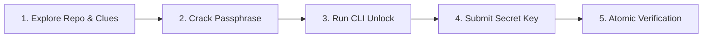
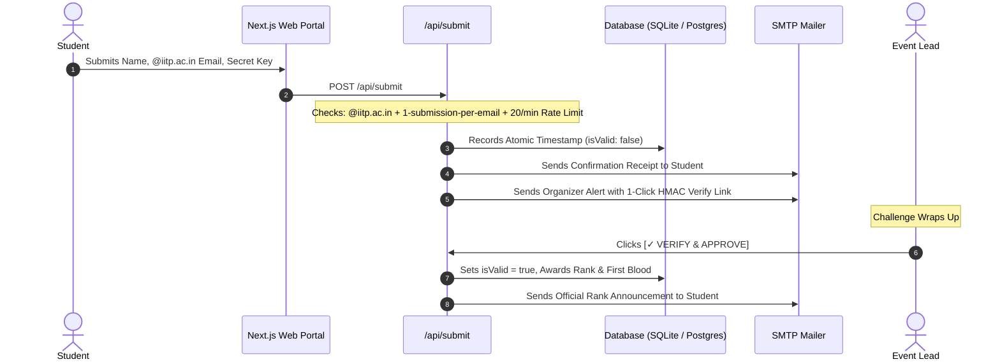

<div align="center">

  

  # ⚡ THE HIDDEN KEY
  ### A Cryptographic Code Mystery Hunt &bull; 2026
  
  <p align="center">
    <strong>Crafted with passion by APPISTRY</strong><br/>
    <em>App Development Club &bull; Student Technical Council (STC), IIT Patna Hybrid</em>
  </p>

  <p align="center">
    <a href="https://nextjs.org"></a>
    <a href="https://www.typescriptlang.org"></a>
    <a href="https://tailwindcss.com"></a>
    <a href="https://www.prisma.io"></a>
    
    
  </p>

  <p align="center">
    <a href="#-about-the-hunt">About</a> &bull;
    <a href="#-how-to-participate">How to Play</a> &bull;
    <a href="#-rules-of-engagement">Rules</a> &bull;
    <a href="#-system-architecture">Architecture</a> &bull;
    <a href="#-quickstart">Quickstart</a> &bull;
    <a href="#-deployment">Deployment</a>
  </p>

</div>

---

## 🧭 About The Hunt

> *"Every identity has three parts, but only one combination opens the gate."*

**THE HIDDEN KEY** is an immersive digital mystery hunt designed exclusively for students of **IIT Patna**. 

Unlike standard competitive programming contests or quiz bowls, this challenge bridges the gap between software engineering, code exploration, cryptographic reasoning, and terminal sleuthing. Participants must explore the repository codebase, inspect commits and cryptic clues, decipher the 3-part passphrase, run offline decryption utilities, and submit the authentic secret keyword to claim the **First Blood Bounty** on the live leaderboard.

---

## 🎮 How to Participate



### Step 1 &bull; Clone and Investigate
Inspect the project tree, explore the hints published on the live stage, and analyze the encrypted payload hidden inside:
```bash
git clone https://github.com/ravi-c029/the-hidden-key.git
cd the-hidden-key
npm install
```

### Step 2 &bull; Solve the Mystery Clues
Explore the cryptic hints published on the live stage. Connect the dots across council identity, institutions, and innovation to deduce the secret passphrase.

### Step 3 &bull; Run the Offline Decryption Utility
When you think you have cracked the passphrase, execute the built-in terminal CLI:
```bash
npm run unlock
```
If your passphrase is correct, the cryptographic cipher will decrypt the secure payload and reveal the secret keyword.

### Step 4 &bull; Submit via the Live Portal
Navigate to `/submit` on the web portal:
* Enter your **Full Name**.
* Enter your official **`@iitp.ac.in`** student email address.
* Enter your discovered **Secret Keyword**.

---

## 🛡️ Rules of Engagement

| # | Rule | Description |
|---|------|-------------|
| **01** | **IIT Patna Only** | Submissions strictly require an authentic `@iitp.ac.in` email address. |
| **02** | **Single Submission** | Each student email is permitted exactly **1 submission**. Make sure your discovered key is correct before submitting. |
| **03** | **Global Rate Limit** | Submissions are rate-limited to a maximum of **20 per minute** across the entire platform. If traffic surges, try again in the next minute window. |
| **04** | **Atomic Timestamps** | Leaderboard ranks are determined by microsecond-accurate server timestamps. |
| **05** | **First Blood Bounty** | The very first participant whose submission verifies successfully claims the permanent First Blood title. |
| **06** | **Fair Play Policy** | Automated script spamming, brute-force dictionary attacks, or DoS attempts will trigger immediate disqualification. |

---

## 🏗️ System Architecture



### Key Technical Highlights
* **Zero Client Leakage:** The secret keyword is never embedded in client JS bundles. Verification happens entirely server-side with timing-safe SHA-256 comparisons (`crypto.timingSafeEqual`).
* **1-Click HMAC Approval:** Organizer verification tokens use HMAC-SHA256 signatures, preventing spoofing and unauthorized approvals.
* **Dual Database Adaptability:**
  * **Development:** Zero-configuration local SQLite (`prisma/schema.prisma`).
  * **Production (Vercel):** Seamless PostgreSQL switcher (`npm run use:postgres`) optimized for Neon or Supabase connection pools.
* **Warm Human Experience:** Clean, obsidian cyber aesthetics with responsive glass cards, cyber grids, and human-written notifications.

---

## 🚀 Quickstart

### Prerequisites
* Node.js 18+ (Node 20+ recommended)
* npm, pnpm, or yarn

### 1. Installation
```bash
git clone https://github.com/ravi-c029/the-hidden-key.git
cd the-hidden-key
npm install
```

### 2. Environment Setup
Copy the environment template:
```bash
cp .env.example .env
```
Ensure your `.env` contains:
```env
EVENT_SECRET_KEYWORD="REPLACE_WITH_ACTUAL_SECRET_KEYWORD"
SESSION_SECRET="your-ultra-secure-hmac-secret"
SMTP_HOST="smtp.gmail.com"
SMTP_PORT="465"
SMTP_USER="organizer@gmail.com"
SMTP_PASS="your-gmail-app-password"
ORGANIZER_NOTIFICATION_EMAIL="organizer@gmail.com"
```

### 3. Database Initialization
```bash
npx prisma generate
npx prisma db push
npm run db:seed
```

### 4. Start Development Server
```bash
npm run dev
```
Open [http://localhost:3000](http://localhost:3000) in your browser.

---

## 🌐 Deployment to Vercel

To deploy seamlessly to Vercel Serverless with PostgreSQL (Neon / Supabase):

1. **Switch schema to PostgreSQL:**
   ```bash
   npm run use:postgres
   ```
2. **Push schema to your cloud database:**
   ```bash
   npx prisma db push
   npm run db:seed
   ```
3. **Deploy to Vercel:**
   Push your repository to GitHub, import it into Vercel, and configure your Environment Variables (`DATABASE_URL`, `EVENT_SECRET_KEYWORD`, `SMTP_*`, `NEXTAUTH_SECRET`).

---

## 📁 Repository Structure

```
appistry-hidden-key/
├── public/
│   ├── images/
│   │   └── appistry-logo.png     # Official APPISTRY emblem
│   ├── cyber-hacker-blue.png     # 3D Cyber character asset
│   └── challenge/
│       └── artifact.enc.json     # Encrypted mystery artifact
├── prisma/
│   ├── schema.prisma             # SQLite schema (Development)
│   ├── schema.postgresql.prisma  # PostgreSQL schema (Production)
│   └── seed.ts                   # Seeds official clues & config
├── scripts/
│   ├── unlock.js                 # Terminal CLI unlocker (npm run unlock)
│   └── switch-db.js              # Database engine switcher
├── src/
│   ├── app/
│   │   ├── api/
│   │   │   ├── submit/           # Atomic submission endpoint
│   │   │   ├── submissions/verify# 1-Click HMAC verification
│   │   │   └── leaderboard/public# Live leaderboard feed
│   │   ├── submit/               # Submission gateway page
│   │   ├── leaderboard/          # Public rankings page
│   │   ├── mission/              # Story & mission briefs
│   │   └── rules/                # Official rules of engagement
│   ├── components/               # Cyberpunk UI, grids & stages
│   └── lib/
│       ├── email/mailer.ts       # SMTP notification engine
│       └── security/verify.ts    # Rate limiting & cryptographic logic
└── package.json
```

---

<div align="center">
  <sub>Organized with ❤️ by <strong>APPISTRY</strong> &bull; App Development Club of STC IIT Patna Hybrid</sub><br/>
  <sub>© 2026 APPISTRY &bull; All Rights Reserved</sub>
</div>
